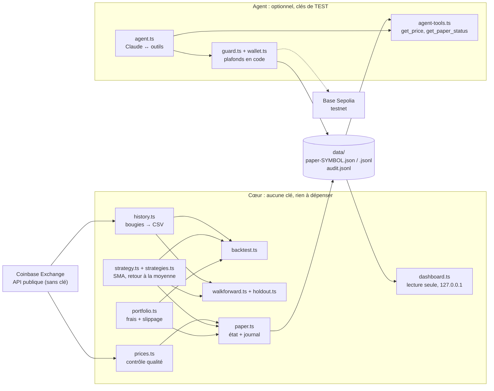

# Architecture

## Vue d'ensemble

Le projet a deux moitiés volontairement séparées :

- **Le cœur** évalue et suit une stratégie de trading avec des données réelles et de l'argent fictif. Il ne détient **aucune clé** et ne peut rien dépenser.
- **L'agent** (optionnel) est une boucle Claude ↔ outils, avec un wallet de **testnet** borné par un garde-fou écrit en code.

## Stack technique

| Domaine | Choix | Pourquoi |
|---|---|---|
| Langage | **TypeScript 5.9** (strict, modules ES) sur **Node.js ≥ 22.12** | Typage fort pour du code financier ; un seul langage pour le cœur, l'agent et le tableau de bord. |
| Exécution | **tsx** (pas d'étape de build) | Démarrage simple, pas de dossier `dist` à garder synchronisé. |
| Tests | **Vitest 5** | Rapide, TypeScript natif. Tous les tests tournent hors ligne. |
| CI | **GitHub Actions** | Typecheck + tests sur Node 22 et 24, construction et test de l'image Docker. |
| Données de marché | **API publique Coinbase Exchange** (ticker, bougies) | Sans clé, stable, documentée. **Pyth** a été écarté : son endpoint de prix répond 401 sans authentification. |
| Agent IA | **SDK Anthropic** (Claude, modèle réglable via `ANTHROPIC_MODEL`) | Appel d'outils natif. |
| Actions on-chain | **Coinbase AgentKit** 0.10 + **viem** | Wallet et actions prêts à l'emploi ; viem pour le client EVM. |
| Réseau | **Base Sepolia** (testnet) | Fixé en dur : impossible de viser le mainnet par configuration. |
| Schémas d'outils | **zod** + zod-to-json-schema | Validation à l'exécution des arguments choisis par le LLM. |
| Stockage | **Fichiers JSON / JSONL** | Un seul processus écrivain, données modestes, lisibles à la main, aucune base à administrer. |
| Tableau de bord | **`node:http`** + HTML/SVG sans framework | Zéro dépendance front, CSP stricte, rien à compiler. |
| Conteneurs | **Docker** (`node:22-slim`) + Compose | Suivi continu, utilisateur non privilégié, système de fichiers en lecture seule. |

Les paquets de l'agent (AgentKit, viem, SDK Anthropic, zod) sont des **`optionalDependencies`** : l'image Docker du cœur ne les installe pas (≈ 12 Mo de dépendances au lieu de ≈ 1,5 Go) et n'a donc ni code de wallet, ni accès à une clé.

L'image s'installe depuis un **verrou dédié** (`docker/package.json` + `docker/package-lock.json`, seulement `tsx` et `dotenv`), pas depuis le `package-lock.json` du projet. Raison, constatée en réel : un `npm install` local avec npm 11 ou 12 réécrit le verrou principal d'une façon que le npm 10 de l'image refuse (`Missing: zod@3.25.76 from lock file`). `tests/docker-deps.test.ts` garantit que les deux `package.json` restent alignés et que le cœur n'importe aucun paquet absent de l'image.

## Frontières de confiance

| Composant | Peut | Ne peut pas |
|---|---|---|
| **LLM (Claude)** | Choisir un outil, lire un prix, lire l'état du trading papier, demander un envoi de testnet | Dépasser un plafond, viser le mainnet, lancer/arrêter le trading papier, modifier la stratégie ou les fichiers |
| **`guard.ts`** | Refuser toute transaction hors règles, écrire le journal d'audit | Être contourné par un prompt : ce sont des règles en code, hors du contexte du modèle |
| **Cœur (papier, backtest…)** | Lire des prix publics, écrire dans `data/` | Signer, envoyer, ou lire une clé privée |
| **Tableau de bord** | Lire `data/` et l'afficher | Écrire, lancer une commande, accepter autre chose que GET/HEAD, répondre à un hôte non local |

Défenses du tableau de bord : écoute sur `127.0.0.1`, vérification de l'en-tête `Host` (contre le DNS rebinding), CSP avec nonce (`default-src 'none'`), rendu par `textContent` uniquement, chemins construits à partir d'un symbole validé (`^[A-Z0-9]{2,10}$`), messages d'erreur sans chemin système.

## Règles de rigueur dans le moteur

1. **Pas d'anticipation :** le signal calculé sur la barre *i* s'exécute au prix de la barre *i+1*, partout (backtest et papier, par le même `Portfolio`).
2. **Les coûts sont toujours payés :** frais et slippage à chaque trade, y compris pour la référence « acheter-garder ».
3. **Un mauvais prix ne produit pas de signal :** prix périmé, trop incertain ou erreur réseau → le tick est sauté et la stratégie n'est pas alimentée.
4. **Aucune donnée non définitive :** la bougie en cours est écartée à l'import.
5. **Le futur ne sert jamais à choisir :** en walk-forward, les paramètres d'une fenêtre ne lisent que son passé (testé par modification du futur, puis vérifié par mutation).
6. **Un test doit pouvoir dire oui :** cas témoin positif (retour à la moyenne simulé) et négatif (marche aléatoire).
7. **Un juge impartial :** la période réservée n'est évaluée qu'une fois, et chaque regard est compté.

## Formats de fichiers (`data/`)

- `paper-<SYMBOL>.json` : état complet du trader papier (version, stratégie, coûts, portefeuille, historique de prix récent, ordre en attente). Écrit de façon atomique (fichier temporaire puis renommage). Un changement de symbole, de stratégie ou de coûts est refusé sans `--reset`.
- `paper-<SYMBOL>.jsonl` : journal, une ligne JSON par événement : `tick` (prix, signal, capital), `trade` (sens, prix obtenu, quantité, frais), `skipped` (raison du refus).
- `audit.jsonl` : décisions du garde-fou (`denied`, `simulated`, `sent`).
- `STOP` : s'il existe, le mode papier et le wallet s'arrêtent.
- `holdout-log.json` : nombre de regards sur chaque période réservée.
- `history/*.csv` : bougies importées.

## Ce qui n'est volontairement pas construit

- **Exécution sur un vrai marché :** Base Sepolia n'a ni liquidité ni vrais prix ; y « trader » n'apprendrait rien sur la stratégie. Le mode papier est l'étape pertinente.
- **Mainnet :** projet distinct, avec un autre niveau d'exigence (clés dans un coffre, plafonds minuscules, revue, supervision).
- **Prédiction de prix par le LLM :** le LLM explique et surveille ; les décisions de trading viennent de code déterministe testable.

## Limites connues

- Le garde-fou ne couvre que `sendTransaction` (pas les signatures, pas les montants de tokens ERC-20).
- Le prix est celui du dernier échange sur une seule plateforme.
- Une année d'historique et une seule paire ne suffisent pas à conclure ; le résultat négatif actuel est un constat, pas une preuve.
- Le tableau de bord n'a pas d'authentification : il est local par conception.
